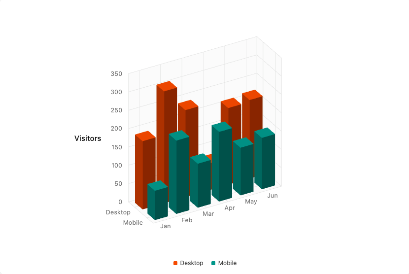
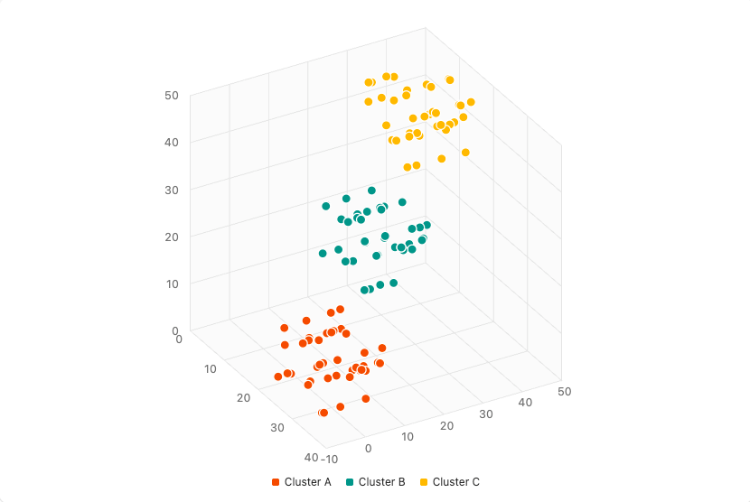
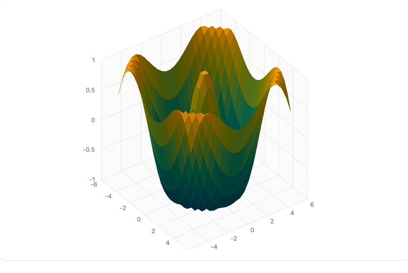

<p align="center">
  <a href="https://github.com/sponsors/niekes"></a>
</p>

<p align="center">
  <strong>3D charts for <a href="https://ui.shadcn.com">shadcn/ui</a>, built on <a href="https://github.com/niekes/d3-3d">d3-3d</a>.</strong><br>
  Free and open source, kept alive by one maintainer and the people who sponsor the work.
</p>

<p align="center">
  <a href="https://github.com/niekes/charts-3d/actions/workflows/main.yml"></a>
  <a href="https://github.com/niekes/charts-3d/actions/workflows/main.yml"></a>
  <a href="https://fallow.tools/docs/explanations/health/"></a>
  <a href="https://ui.shadcn.com/docs/registry"></a>
  <a href="https://www.npmjs.com/package/d3-3d"></a>
  <a href="https://github.com/niekes/charts-3d/blob/master/LICENSE"></a>
  
  <a href="https://github.com/niekes/charts-3d"></a>
  <a href="https://github.com/sponsors/niekes"></a>
</p>

<p align="center">
  <a href="https://niekes.github.io/charts-3d/docs">Docs</a> ·
  <a href="https://niekes.github.io/charts-3d/docs/installation">Installation</a> ·
  <a href="https://niekes.github.io/charts-3d/docs/components/bar-chart-3d">Components</a> ·
  <a href="https://niekes.github.io/charts-3d/docs/theming">Theming</a> ·
  <a href="https://niekes.github.io/charts-3d/docs/how-it-works">How it works</a>
</p>

---

<table>
    <tr style="background-color: #f6f8fa">
        <td><a target="_blank" href="https://niekes.github.io/charts-3d/docs/components/bar-chart-3d"></a></td>
        <td><a target="_blank" href="https://niekes.github.io/charts-3d/docs/components/scatter-chart-3d"></a></td>
        <td><a target="_blank" href="https://niekes.github.io/charts-3d/docs/components/surface-chart-3d"></a></td>
    </tr>
</table>

Copy-paste components, plain SVG, themed by the `--chart-*` tokens you already have. They render on the server, take the same `ChartConfig` as the chart of shadcn/ui and turn on drag and on the arrow keys.

## Sponsor charts-3d

**charts-3d** is free, and it always will be. There is no company behind it — just one maintainer working in spare time — so the cost of keeping it alive is paid for by the people who depend on it.

If charts-3d saves you time, [become a sponsor](https://github.com/sponsors/niekes).

| Tier        | What you get                                                                                |
| ----------- | ------------------------------------------------------------------------------------------- |
| **$5/mo**   | Your name in the [sponsors list](#sponsors) and my sincere thanks                           |
| **$25/mo**  | The above, plus your logo in the README and on the docs site, and priority issue triage     |
| **$100/mo** | The above, plus direct email access for feature requests and a mention in the release notes |

Where the money goes:

- **Issue triage and bug fixes.** Sponsorship buys a reply within a couple of days instead of whenever I get to it.
- **Components that keep up.** Keeping the registry in step with shadcn/ui, React, Tailwind CSS and d3-3d.
- **The documentation site.** Hosting, builds and the live examples.
- **Time for new work.** More charts, transitions, and eventually a WebGL renderer for large data.

Prefer a one-off? The [sponsor page](https://github.com/sponsors/niekes) also takes one-time contributions.

**Need a company sponsorship or an invoice?** [Get in touch](mailto:s@niekes.com).

## Sponsors

Thank you to the people who make this possible. Sponsors at $25/mo and above get their logo in this README and on the docs site; everyone gets their name below.

<!-- New sponsors go below this line, one per line. -->

## Using charts-3d

```bash
npx shadcn@latest add niekes/charts-3d/bar-chart-3d
```

Everything else lives in the [documentation](https://niekes.github.io/charts-3d/docs): [installation](https://niekes.github.io/charts-3d/docs/installation), the [components](https://niekes.github.io/charts-3d/docs/components/bar-chart-3d), [theming](https://niekes.github.io/charts-3d/docs/theming) and [how it works](https://niekes.github.io/charts-3d/docs/how-it-works).

charts-3d is not affiliated with shadcn/ui.

## Star History

[](https://www.star-history.com/#niekes/charts-3d&type=date&legend=bottom-right)
